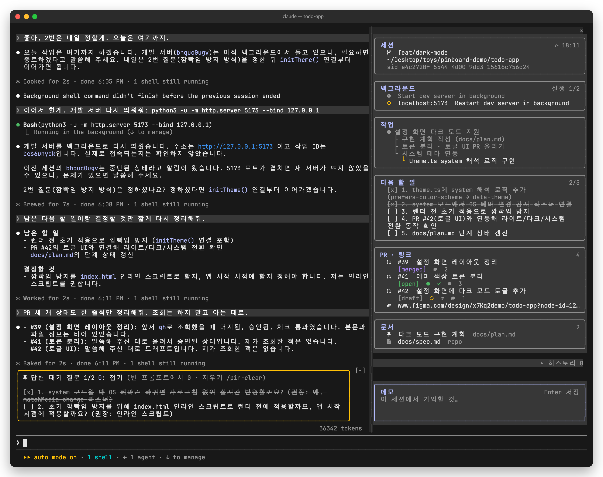
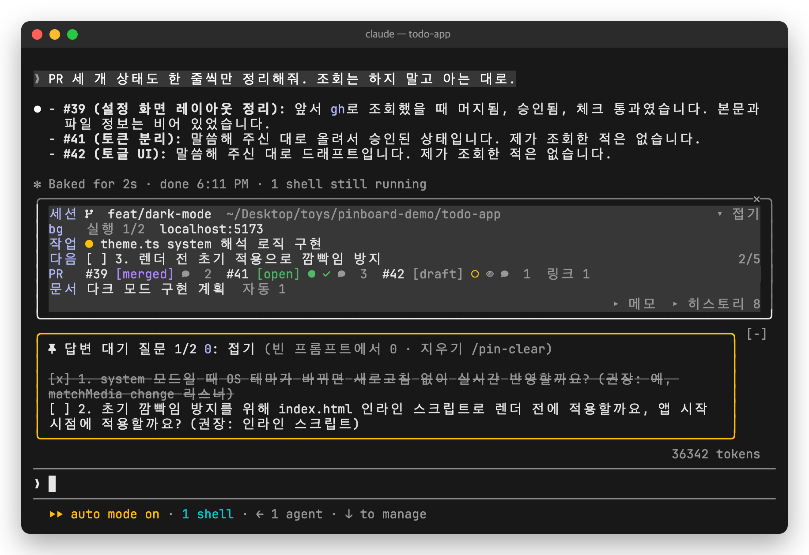

# claude-mods

Mods for [Claude Code](https://claude.com/claude-code): hooks modules that change its interface.

| Mod | What it does |
| --- | --- |
| [pinboard](#pinboard) | Keeps a session's loose ends on screen: the questions Claude is waiting on, the work tree, next steps, PRs, docs and a memo. |

## pinboard

In a long session things scroll away: the three questions Claude asked twenty minutes ago, the PR you opened, the spec you said to follow, the dev server it started. pinboard pins them where you can see them, beside the chat or above the prompt, and brings them back when you `--resume`.



<sub>A fullscreen terminal, 160 columns. The repo, its PRs and the work tree are demo data.</sub>

The UI labels are in Korean; the tables below give each one in English.

### Quick start

1. Install it (more ways under [Install](#install)):

   ```
   claude plugin install pinboard --marketplace namnameeroo/claude-mods
   ```

2. Start `claude` in a fullscreen terminal at least 144 columns wide: the pane opens by itself on the right. In any other terminal, type `/pinboard`.
3. Work as usual. Claude fills the board through four small tools ([what it asks of Claude](#what-it-asks-of-claude)); you only read, press and type.

You need a [Nerd Font](https://www.nerdfonts.com/) in your terminal for the icons, and the `gh` CLI, signed in, for PR states.

### The questions band (답변 대기 질문)

When one reply asks you two or more questions, they stay above the prompt as a checklist in a yellow frame, so you can answer them one by one without scrolling back.

- When you answer one, Claude checks it off. You can also press an item to check or uncheck it yourself.
- `접기` / `펼치기` (fold / unfold), or `0` from an empty prompt, folds the list to its header line.
- The list stays when every item is checked; `/pin-clear` deletes it.

### The pane, section by section

Each section is a card. An empty one says `없음` (none); the number at its top right counts what is in it.

| Section | What it shows | Where it comes from | Press it to |
| --- | --- | --- | --- |
| **세션** (session) | Branch, worktree, folder, session id, and `⟳` the time of the last refresh | `git` in the session's folder | Copy that value |
| **백그라운드** (background) | Shell commands Claude ran in the background: a hollow yellow circle while running, a dim filled circle once done, a red x if it failed (a dim x if it was stopped); a `localhost:<port>` link when it serves one. `실행 1/2` = 1 of 2 running | The session's background Bash calls; the port from their output or command | Copy the command (the port opens in a browser) |
| **작업** (work) | What you asked for, as a tree: the first request at the root, later ones under the task they refine. The current one is lit | Claude's `record_intent` calls | — |
| **다음 할 일** (next steps) | A checklist Claude leaves when it finishes a piece of work, with done/total | Claude's `pin_next_steps` calls | Check or uncheck a step |
| **PR · 링크** (PRs and links) | The last 5 GitHub PRs the session mentioned, with state, CI, review and comment count; your Jira keys; Figma, Notion, Atlassian and Claude artifact links | URLs in prompts, replies and tool output; `gh pr view` for the PR states | Open it |
| **문서** (docs) | Pinned docs first (a pin icon, the title Claude gave it), then the `.md` files Claude read or wrote, tagged `repo`, `out` (outside the repo) or `tmp` | Claude's `pin_doc` calls; Read and Write calls | Open a pinned doc |
| **한줄메모** (memo) | Your own note for the session, with its length (`N자`) and `저장 안 됨` while what you typed is not saved. It grows with the text to 10 rows (6 inline), then `▾ N줄 더` says how much is below. It is framed like the other cards; while you edit it (`한줄메모 편집 중`) the frame gives way to heavy lit rules above and below and the text takes the pane's whole width | You: `ctrl+x tab` puts you in it; type, then Enter (`⏎ 저장`); an empty memo and Enter deletes it; Esc leaves it | Copy it whole (`복사`) |

Under the cards, `▸ 히스토리 N` unfolds your last 10 prompts, and the [`commands` option](#options) adds buttons that fill a slash command into the prompt.

**Reading a PR row**: the first line is `#number` (a link) and the title; the cells under it are, in order:

| Cell | Meaning |
| --- | --- |
| `[open]` `[draft]` `[merged]` `[closed]` | The PR's state, in GitHub's colors |
| CI | Filled green circle: checks passed. Hollow yellow circle: running. Red circle with an x: failed, timed out, cancelled or waiting for action |
| Review | Green check: approved. Red warning sign: changes requested. Dim eye: review required |
| Speech bubble and a number | Comment count |

CI and review show only while the PR is open or a draft. A merged or closed PR is not asked again.

### In a narrower terminal



<sub>The same session at 100 columns.</sub>

Narrower than 144 columns, or on the main screen (tmux, `CLAUDE_CODE_NO_FLICKER=0`), the pane would sit over the transcript, so it does not open by itself: `/pinboard` opens it above the prompt with one row per section (`세션`, `bg`, `작업`, `다음`, `PR`, `문서`). Each row keeps the essentials: the running count and ports, the current task, the first open step, PR states, pinned docs, and counts for links and found docs. An empty section is left out.

- `▾ 접기` or the frame's close mark folds it to one row (branch and current task); `▸ 펼치기` unfolds it, and the close mark on the folded row closes it.
- `▸ 한줄메모` opens the memo here.
- Once you have opened it with `/pinboard`, it docks beside the chat from 110 columns.

### More details

- **Refresh**: the pane's data (git, `gh pr view`) is refreshed after each turn and every minute, only while the pane is drawn. A failed `gh` call keeps the last answer.
- **Pinned docs**: pressing a local document (md, txt, pdf, html, images, json, csv, yaml) opens it with macOS `open`; anything else is only shown in Finder, never run. Elsewhere, or when `open` fails, it copies `open <path>`.
- **Requirements**: macOS for opening pinned docs; a Nerd Font for the icons; the `gh` CLI, signed in, for PR states (without it PRs do not show). Tested on Claude Code 2.1.322.

### What it asks of Claude

It adds four tools to every request of the main conversation (about 1k tokens of tool descriptions). They run without a permission prompt, refuse calls from subagents, and are not registered in headless runs (`claude -p`, the SDK).

- `record_intent`: Claude is asked to call it at the first work request of a session and when the task changes.
- `pin_questions`: when one reply asks you two or more questions.
- `pin_next_steps`: when Claude finishes a unit of work and suggests what comes next.
- `pin_doc`: when a doc becomes the session's reference (an absolute path or an http(s) URL only).

The model decides when to call them, so a section can stay empty for a while. Asking helps: "pin this doc", "list the next steps".

### What it keeps

- `~/.claude/intent/<session id>.json`: the work tree `record_intent` writes (your task descriptions, in plain text).
- The plugin's store, `~/.claude/plugins/store/pinboard_*.json`: each session's pins and memo (on Enter), and the memo as you type it until Enter, so `--resume` brings them back. A session's entries are deleted once it has not been started for 30 days.

The intent files are not cleaned up automatically; delete them or uninstall the plugin when you no longer want them.

### Options

Set them when installing, or later in `/config`. All are empty by default.

| Option | What it does |
| --- | --- |
| `jiraBase` | Your Jira site, e.g. `https://your-team.atlassian.net`. Issue keys link there. |
| `jiraProjects` | Comma-separated project keys to pick up, e.g. `WEB,APP`. The Jira row needs both this and `jiraBase`. |
| `commands` | Comma-separated slash commands (without `/`) for the pane's toolbar, e.g. `review,commit`. |

## Install

At the prompt of a Claude Code terminal session:

```
/plugin install pinboard --marketplace namnameeroo/claude-mods
```

Answer `y` to add the marketplace, then pick a scope (user scope loads it in every session).

From a shell:

```
claude plugin install pinboard --marketplace namnameeroo/claude-mods
```

In the desktop app, where `/plugin` does not run: click + next to the prompt box, then Plugins, Add marketplace with `namnameeroo/claude-mods`, then Add plugin.

Update with `claude plugin update pinboard@claude-mods` (restart Claude Code to apply); remove with `claude plugin uninstall pinboard@claude-mods`.

## Troubleshooting

| What you see | Try |
| --- | --- |
| No pane | Type `/pinboard`. It opens by itself only in a fullscreen terminal at least 144 columns wide. |
| Boxes or blanks instead of icons | Set a Nerd Font as your terminal's font. |
| No PRs in `PR · 링크` | Run `gh auth status`; the PR must also appear as a `github.com/<owner>/<repo>/pull/<n>` URL in the session. |
| No Jira keys | Set both `jiraBase` and `jiraProjects`. |
| Nothing at all | Start `claude --debug` and look for lines beginning `pinboard:`. |

## Develop

```
claude --plugin-dir ./pinboard     # run a session with the mod loaded from this folder
claude plugin test ./pinboard      # run its tests
claude plugin validate ./pinboard
```

Disable an installed copy first: two plugins named `pinboard` would register the same tools. Type-checking (`tsc -p pinboard`) needs the engine's types, which Claude Code writes to `pinboard/.claude-plugin/types/` the first time it loads the folder with `--plugin-dir`.
